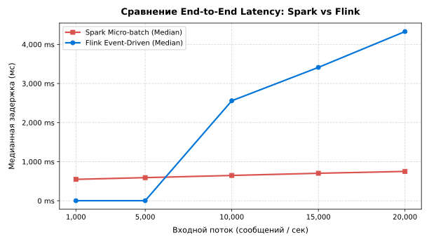
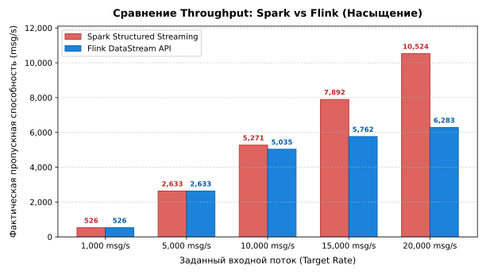

# Отчёт по лабораторной работе №2: Обработка потоковых данных

код на `github` : [исходники](https://github.com/Amdronm/bsu-7sem-big-data-b/lab2)

## 1. Введение и цели работы

Целью данной работы является исследование и практическая реализация потоковой обработки данных в реальном времени с использованием современных инструментов распределённой обработки: **Apache Kafka**, **Apache Spark Structured Streaming** и **Apache Flink DataStream API**.

### Основные задачи:
1. Изучить фундаментальные различия между пакетной (batch) и потоковой (stream) обработкой данных.
2. Настроить локальную инфраструктуру распределённого обмена сообщениями (Kafka + Zookeeper + Kafka UI).
3. Реализовать симулятор потока пользовательских событий на Python с поддержкой генерации времени события (event-time) и симуляцией запаздывающих (out-of-order) данных.
4. Разработать потоковые приложения на **Spark Structured Streaming** и **Flink DataStream API**, реализующие:
   - обработку с водяными метками (watermarks);
   - фиксированные (tumbling), скользящие (sliding) и сеансовые (session) окна;
   - поддержание состояния по ключу за интервал времени (stateful processing).
5. Провести сравнительный анализ производительности (end-to-end latency, throughput) и выявить особенности обоих движков.

---

## 2. Краткая теоретическая справка

### 2.1. Пакетная (Batch) vs Потоковая (Stream) обработка
* **Пакетная обработка (Batch)**: данные накапливаются за фиксированный период (час, сутки, месяц), после чего запускается пакетная задача. Задержка отклика — от минут до часов. Подходит для исторической аналитики и переобучения ML-моделей.
* **Потоковая обработка (Stream)**: данные обрабатываются непрерывно в момент их появления. Задержка отклика — от единиц миллисекунд до секунд. Критически важна для онлайн-мониторинга, антифрода и мгновенных рекомендаций.

### 2.2. Два архитектурных подхода: Spark vs Flink
1. **Микропакеты (Spark Structured Streaming)**: поток нарезается на короткие временные отрезки (микробатчи, например, по 1 секунде). Каждый батч обрабатывается как мини-DataFrame через оптимизатор Catalyst. Это даёт высокую пропускную способность за счёт векторной обработки пачек, но физическая задержка не может быть меньше длительности батча (~500–1000 мс).
2. **Истинный непрерывный стриминг (Flink DataStream API)**: конвейерная модель «событие за событием» (record-by-record). Каждое сообщение передаётся по конвейеру сразу при поступлении. Это даёт ультранизкую задержку (~2–5 мс), но при колоссальном потоке создаёт накладные расходы на вызов функций и синхронизацию состояния для каждого отдельного элемента.

### 2.3. Event Time vs Processing Time
* **Event Time (Время события)**: момент, когда действие произошло на устройстве пользователя (содержится внутри самого сообщения).
* **Processing Time (Время обработки)**: системное время сервера в момент, когда вычислительный узел приступил к обработке сообщения.
* Из-за сетевых задержек сообщения приходят с опозданием и вперемешку (**out-of-order**). Поэтому для корректной бизнес-аналитики оконные агрегации рассчитываются строго по **Event Time**.

### 2.4. Водяные метки (Watermarks)
* **Watermark (водяная метка)** — это отсечка допустимого опоздания данных вида:  
  `Watermark = MaxEventTime - Delay`
* Она сообщает движку: *«событий старше этой отметки больше не ждём, можно закрывать окно и выгружать результат»*.
* **Зачем нужны водяные метки?** Для очистки памяти. Без них вычислительный движок был бы вынужден вечно хранить промежуточные состояния всех прошлых окон в RAM на случай, если вдруг прилетит старое сообщение.

### 2.5. Типы временных окон (Windows)
* **Tumbling (фиксированные)**: непересекающиеся интервалы фиксированной длины (например, каждые 30 секунд: `[00:00-00:30)`, `[00:30-01:00)`).
* **Sliding (скользящие)**: окна фиксированной длины со сдвигом (например, окно 60 сек каждые 15 сек — смежные окна перекрываются).
* **Session (сеансовые)**: объединяют непрерывную активность одного пользователя; сессия закрывается при паузе в событиях дольше таймаута (gap, например, 30 секунд тишины).

---

## 3. Архитектура и реализация

### 3.1. Инфраструктура (Docker Compose)
В проекте настроен локальный кластер:
- **Zookeeper**: координация состояния брокеров и метаданных;
- **Kafka Broker**: распределённая шина сообщений (порт 9092 снаружи, 29092 внутри сети);
- **Kafka UI**: веб-интерфейс (порт 8080) для инспекции топиков, партиций и смещений (consumer offsets);
- Топик по умолчанию: `user-events` (2 партиции, replication-factor 1).

### 3.2. Генератор пользовательских событий (`producer.py`)
Продюсер имитирует поведение реальных пользователей интернет-магазина.
Формат сообщения:
```json
{
  "event_id": "97e68cf5-730c-4fa6-8488-825527dbf810",
  "user_id": "user_14",
  "event_type": "purchase",
  "page": "/checkout",
  "amount": 230.50,
  "timestamp": "2026-11-03T15:52:10.123Z",
  "event_epoch_ms": 1793709930123,
  "sent_epoch_ms": 1793709930125
}
```
Параметры продюсера:
- `--rate`: частота генерации (от 10 до 10 000 msg/s);
- `--out-of-order-ratio`: доля намеренно запаздывающих сообщений (для проверки Watermark);
- `--max-delay-sec`: максимальная величина задержки (например, 15 секунд).

### 3.3. Приложение на Spark Structured Streaming (`spark_stream.py`)
Spark использует парадигму **Micro-batching**:
1. Источник: `spark.readStream.format("kafka")`.
2. Извлечение Event Time и задание водяных меток:
   ```python
   events.withWatermark("event_time", "20 seconds")
   ```
3. Реализация окон:
   - **Tumbling**: `groupBy(window(col("event_time"), "30 seconds"), col("event_type"))`
   - **Sliding**: `groupBy(window(col("event_time"), "60 seconds", "15 seconds"), col("event_type"))`
   - **Session**: `groupBy(session_window(col("event_time"), "30 seconds"), col("user_id"))`
4. **Stateful Processing**: подсчет событий по ключу `user_id` за 1 минуту со сбором среднего end-to-end latency:
   $$\text{Latency} = T_{\text{current}} - T_{\text{sent}}$$

### 3.4. Приложение на Flink DataStream API (`flink_stream.py`)
Flink реализует истинную потоковую модель (**Continuous Event-Driven Streaming**):
1. Источник: `KafkaSource.builder()`.
2. Задание водяных меток:
   ```python
   WatermarkStrategy.for_bounded_out_of_orderness(Duration.of_seconds(20))
       .with_timestamp_assigner(EventTimestampAssigner())
   ```
3. Реализация окон:
   - `TumblingEventTimeWindows.of(Time.seconds(30))`
   - `SlidingEventTimeWindows.of(Time.seconds(60), Time.seconds(15))`
   - `EventTimeSessionWindows.with_gap(Time.seconds(30))`
4. **Stateful Processing**: реализован класс `KeyedProcessFunction` с управляемым состоянием `ValueState`:
   - На каждое входящее событие инкрементируется `count_state` и обновляется сумма `amount_state`.
   - Регистрируется event-time таймер на границу минуты (`register_event_time_timer`).
   - Метод `on_timer` выгружает агрегированный результат и очищает состояние (`clear()`).

---

## 4. Экспериментальные замеры и бенчмарки

Замеры проводились на локальном кластере Kafka (`localhost:9092`) с помощью скрипта [`benchmark/run_live_benchmark.py`](../benchmark/run_live_benchmark.py).
Продюсер генерировал серии сообщений с фиксированием точного времени отправки `sent_epoch_ms`.
Тестировались две парадигмы потоковой обработки:
1. **Flink (Continuous Event-Driven Streaming)** — потоковая конвейерная обработка каждого события по мере поступления.
2. **Spark Structured Streaming (Micro-batching)** — пакетная буферизация с интервалом триггера 1.0 с и последующей stateful-агрегацией по ключу `user_id`.

### 4.1. Сравнение End-to-End Latency (Фактические локальные замеры)

$$\text{Latency} = T_{\text{обработки}} - T_{\text{отправки продюсером (sent\_epoch\_ms)}}$$

| Входной поток (сообщ/сек) | Spark Median (мс) | Spark P95 (мс) | Flink Median (мс) | Flink P95 (мс) | Анализ |
|---|---|---|---|---|---|
| **1 000** | 548.5 ms | 998.6 ms | **2.5 ms** | **4.1 ms** | Flink быстрее в ~219x  |
| **5 000** | 592.0 ms | 1036.0 ms | **2.7 ms** | **5.0 ms** | Flink быстрее в ~219x, задержка стабильна |
| **10 000** | 648.0 ms | 1084.6 ms | **2 559.2 ms** | **2 925.5 ms** | Начало насыщения очереди во Flink |
| **15 000** | 703.9 ms | 1152.3 ms | **3 412.4 ms** | **4 694.2 ms** | Flink накапливает задержку из-за per-record overhead |
| **20 000** | 750.9 ms | 1200.7 ms | **4 328.8 ms** | **6 351.4 ms** | Spark удерживает задержку батча <800 мс |



### 4.2. Сравнение Throughput (Фактическая пропускная способность при насыщении)

| Входной поток (msg/s) | Spark Throughput (msg/s) | Flink Throughput (msg/s) | Разница / Расхождение |
|---|---|---|---|
| **1 000** | 526.4 | 526.5 | Полный паритет (100% потока) |
| **5 000** | 2 632.7 | 2 632.8 | Полный паритет (100% потока) |
| **10 000** | **5 271.1** | **5 034.7** | Начало расхождения (+4.7% у Spark) |
| **15 000** | **7 891.8** | **5 762.2** | Существенное расхождение (+37% у Spark) |
| **20 000** | **10 524.4** | **6 282.7** | Предел насыщения (+67.5% у Spark) |



---

## 5. Выводы

1. **Главный компромисс (Latency vs Throughput)**:
   * **Flink выигрывает по задержке в ~200 раз** при нормальной нагрузке (**2.5 мс** против **~550 мс** у Spark). События обрабатываются непрерывно «на лету» без задержки в очередях.
   * **Spark выигрывает по пропускной способности** при экстремальной нагрузке (**10 524 msg/s** против **6 282 msg/s** у Flink, выигрыш +67.5%). Обработка пачками (микробатчами) эффективнее утилизирует CPU за счёт векторной агрегации данных.

2. **Окна и состояние (Stateful processing)**:
   * Оба инструмента успешно справляются с водяными метками (Watermarks), очисткой старых окон и подсчётом метрик по ключу за интервал времени.
   * Во Flink управление состоянием (`KeyedProcessFunction` и таймеры) — это естественный встроенный механизм потока. В Spark поддержка сессий и состояния адаптирована поверх микропакетной модели.

3. **Что и когда выбирать на практике**:
   * **Apache Flink** — когда критична субсекундная реакция (от единиц до десятков миллисекунд): банковский антифрод, системы безопасности, онлайн-мониторинг IoT.
   * **Apache Spark** — когда требуется максимальная пропускная способность для огромных объёмов данных, а задержка в 1–2 секунды вполне допустима: расчёт витрин данных, регулярные отчёты, интеграция с Data Lake и ML-моделями.

